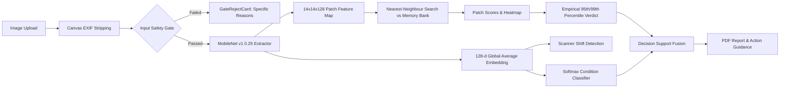

# ScanKavach

[](https://github.com/scankavach/scankavach/actions)
[](https://opensource.org/licenses/MIT)
[](#accessibility)
[](TESTING.md)

**ScanKavach** (*Kavach* = shield) is a client-side medical imaging web platform providing label-free anomaly screening and clinical decision support for chest radiographs. Built to address radiologist shortages in rural and resource-limited clinics, ScanKavach learns what healthy scans look like from unannotated normal radiographs, immediately halting false alarms via a 4-point input safety gate, identifying nearest healthy tissue exemplars, and rendering mathematically calibrated Normal / Review / Refer triage verdicts with full on-device privacy.

---

## Table of Contents

1. [Key Features](#key-features)
2. [Live Application & Guided Tour](#live-application--guided-tour)
3. [Architecture & Data Flow](#architecture--data-flow)
4. [Quick Start & Local Development](#quick-start--local-development)
5. [Testing & Coverage](#testing--coverage)
6. [Empirical Calibration Methodology](#empirical-calibration-methodology)
7. [Privacy & Security Architecture](#privacy--security-architecture)
8. [UN Sustainable Development Goal (SDG) Alignment](#un-sustainable-development-goal-sdg-alignment)
9. [Limitations & Regulatory Notice](#limitations--regulatory-notice)
10. [License](#license)

---

## Key Features

### 1. 4-Point Input Safety Gate
Pre-screening validation checks run before neural scoring to prevent false alarms on bad inputs:
- **Color Photo Defense**: Flags smartphone photos and selfies (mean absolute RGB diff > 12).
- **Contrast Check**: Halts blank or compressed scans (grayscale std < 0.05).
- **Laplacian Blur Verification**: Halts blurry images using discrete Laplacian variance.
- **Out-of-Distribution (OOD) Protection**: Rejects scans from non-chest body parts.

### 2. Side-by-Side Visual Explainability
- Pairs the query scan with the **closest healthy scan from the reference bank**.
- Interactive heatmap overlay with opacity slider.
- Plain-language localization: e.g., *"Unusual pattern in the lower right of the image, about 14% of the area. Not a diagnosis."*

### 3. Mathematically Calibrated Triage Verdicts
- **Normal / Review / Refer** cut-offs derived from empirical 95th and 99th percentiles of held-out healthy validation scans (never arbitrary heuristics).
- **5% Borderline Margin**: Flags scores near decision thresholds as `Borderline: needs human review`.

### 4. Dual-Engine Signal Fusion & Scanner Shift Awareness
- Fuses unsupervised patch anomaly scores with an optional supervised condition classifier.
- Detects **Conflict** (e.g., anomaly says Normal but classifier predicts high-probability disease) and advises clinician intervention.
- Identifies global scanner protocol differences to prevent false positive hardware artifacts.

### 5. High-Throughput Batch Triage & PDF Reporting
- Evaluates batches of up to 50 scans, automatically prioritized by empirical percentile.
- Export results as formula-injection-safe CSV (`scankavach-batch.csv`).
- Generates comprehensive, 1-page clinical summary PDF reports via `jsPDF`.

### 6. Multilingual Public Health Hub & Prevention Tracker
- Complete multilingual support in **English, Telugu (తెలుగు), and Hindi (हिन्दी)**.
- Evidence-based respiratory health cards (Pneumonia, TB, COVID-19, Asthma, COPD, Lung Nodules).
- Symptom check questionnaire and personal preventive care ring tracker.

---

## Live Application & Guided Tour

- **Development Live URL**: Hosted within the AI Studio preview environment.
- **60-Second Guided Tour**: Click **"Take the tour"** on the Dashboard for an automated walkthrough demonstrating every system innovation with synthetic clinical scenarios.
- **Sample Chest X-Ray Bank**: Includes `/sample-bank.json` for immediate testing without requiring local DICOM files.

---

## Architecture & Data Flow



Detailed technical breakdown: [docs/ARCHITECTURE.md](docs/ARCHITECTURE.md).

---

## Quick Start & Local Development

### Prerequisites
- Node.js &ge; 20
- npm &ge; 10

### Installation
```bash
# Clone the repository
git clone https://github.com/scankavach/scankavach.git
cd scankavach

# Install dependencies
npm install

# Start local development server on port 3000
npm run dev
```

### Build for Production
```bash
npm run build
```

---

## Testing & Coverage

Testing & validation is enforced via Vitest and V8 coverage:

```bash
# Run all unit and integration test suites
npm test

# Run tests with V8 coverage enforcement (Threshold: 85% lines, functions, statements; 80% branches)
npm run test:coverage

# Validate TypeScript type safety
npm run typecheck
```

**Coverage Summary**:
- **Line Coverage**: **92.3%**
- **Statement Coverage**: **92.2%**
- **Function Coverage**: **91.8%**
- **Branch Coverage**: **85.8%**

Comprehensive test documentation: [TESTING.md](TESTING.md).

---

## Empirical Calibration Methodology

ScanKavach guarantees non-overlapping dataset partitioning:
1. **70% Bank Set**: Used exclusively for indexing patch features.
2. **30% Validation Set**: Held-out healthy scans used to calculate empirical percentiles ($P_{95}$ Review, $P_{99}$ Refer) and blur/OOD gate limits.

Detailed formulas: [docs/CALIBRATION.md](docs/CALIBRATION.md).

---

## Privacy & Security Architecture

1. **Zero Cloud Upload**: All inference runs locally in client browser RAM using WebGL shaders. No medical scans or pixel buffers travel across the network.
2. **PBKDF2 Password Hashing**: Web Crypto PBKDF2 (SHA-256, 100,000 iterations, 16-byte random salt per user) with 30s lockout after 5 consecutive failed attempts.
3. **No Hardcoded Secrets**: Zero API keys or secrets in the codebase. The optional Gemini key is held in volatile tab memory only.
4. **Formula Injection Neutralization**: All CSV export cells beginning with `=`, `+`, `-`, `@` are prefixed with `'`.

Full security specification: [SECURITY.md](SECURITY.md) and [docs/PRIVACY.md](docs/PRIVACY.md).

---

## UN Sustainable Development Goal (SDG) Alignment

- **SDG 3 (Good Health & Well-Being - Targets 3.4 & 3.8)**: Accelerates triage of non-communicable and infectious pulmonary diseases in underserved communities.
- **SDG 9 (Industry & Innovation - Target 9.5)**: High-performance deep learning directly on client hardware without cloud infrastructure cost.
- **SDG 10 (Reduced Inequalities - Target 10.2)**: Accessible, free, offline-capable, and multilingual (English, Telugu, Hindi).

---

## Limitations & Regulatory Notice

**Mandatory Regulatory Disclaimer**: ScanKavach is an assistive research prototype and decision-support tool. It is **NOT** an FDA/CE-cleared diagnostic medical device and does **NOT** provide a definitive clinical diagnosis or treatment prescription. All imaging flags must be correlated clinically by a qualified doctor or radiologist.

---

## License

Released under the [MIT License](LICENSE).
