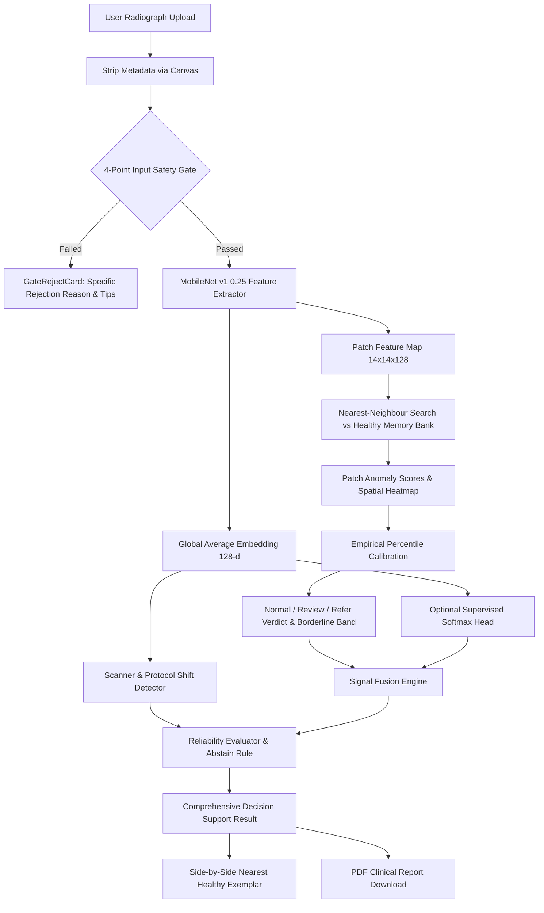

# ScanKavach Architecture & Data Flow

ScanKavach is an entirely client-side, privacy-preserving medical imaging anomaly screening and decision-support web application.

## Module Responsibilities

1. **`src/lib/gate.ts`**: Verifies that input images meet clinical screening validity before executing neural inference. Checks color variance, contrast standard deviation, Laplacian sharpness, and embedding distance.
2. **`src/lib/extractor.ts`**: Lazy-loads MobileNet v1 0.25 (layer `conv_pw_11_relu`) using TensorFlow.js with WebGL acceleration and CPU fallback.
3. **`src/lib/memoryBank.ts`**: Stores sub-sampled patch vectors from healthy reference scans. Performs chunked Euclidean matrix multiplication (`tf.matMul`).
4. **`src/lib/verdict.ts`**: Computes Normal / Review / Refer triage classifications based on empirical 95th and 99th percentiles of a held-out healthy validation set, with a 5% borderline margin.
5. **`src/lib/fusion.ts`**: Reconciles unsupervised anomaly scores with supervised classifier suggestions to output `Consistent-normal`, `Suggested-condition`, `Conflict`, or `Inconclusive`.
6. **`src/lib/reliability.ts`**: Assesses operational confidence and invokes the Abstain rule whenever conflicting signals or scanner protocol shifts are detected.
